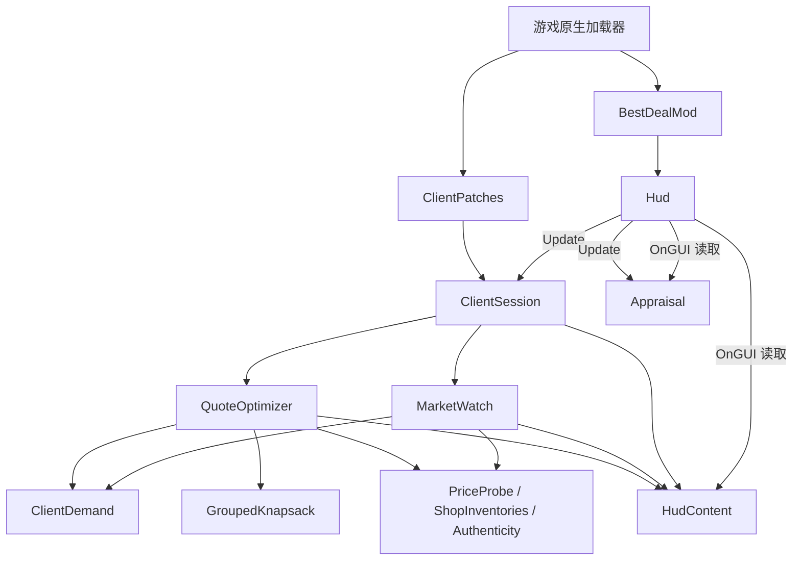

# 系统设计

BestDeal 是游戏进程内的提示工具：读取顾客、库存、行情和鉴定状态，生成文字 HUD，由玩家操作物品。没有存档、网络、后台线程或独立配置服务。当前约千行代码，采用按功能分目录的静态模块；统一保留 `BestDeal` 命名空间，避免引入依赖注入、事件总线等额外框架。

## 代码边界

| 目录 / 模块 | 职责 | 修改时的约束 |
| --- | --- | --- |
| `Runtime/BestDealMod` | 原生 `IMod` 入口、日志、创建持久 HUD | Harmony 由游戏加载器应用，不调用 `PatchAll` |
| `Runtime/ClientPatches` | 对话开始、交易完成的 Harmony 适配 | 只转发事件到会话 |
| `Runtime/ClientSession` | 当前顾客、轮询节流、主面板选择、触发报价 | 功能模块不反向读取会话 |
| `Features/Quotes/ClientDemand` | 需求摘要、需求指纹、预算读取 | 本地化失败回退原始 key |
| `Features/Quotes/QuoteOptimizer` | 候选收集、分组、调用求解器、柜台标记和报价文案 | 不自行计算游戏成交价 |
| `Features/Quotes/GroupedKnapsack` | 纯分组背包算法 | 只依赖 .NET，可脱离游戏验证 |
| `Features/Appraisal/Appraisal` | 放大镜检查时显示实际状态和问题依据，估价面板额外显示价值 | 真值调用游戏 API，评级阈值需跟随游戏升级核对 |
| `Features/Market/MarketWatch` | 开店前的早晨读取新闻、扫描库存、生成行情建议 | 自身按 2 秒节流；顾客优先级交给会话判断 |
| `Game/PriceProbe` | 临时挂柜台价格特征并恢复 | 必须在 `finally` 恢复物品及子物品特征列表 |
| `Game/ShopInventories` | 可售区域枚举、两个后柜台容器及其指纹 | 不扫描垃圾桶、已售陈列、拖拽缓冲等区域 |
| `Game/Authenticity` | 读取赝品特征和游戏本地化理由 | 不触发顾客反应 |
| `Presentation/HudContent` | 主面板标题和行文本 | 单线程共享展示状态 |
| `Presentation/Hud` | Unity Update 驱动和 OnGUI 绘制 | 不扫描库存、不处理报价规则 |

游戏 API 同时出现在功能和适配模块中；这里的目录是职责边界，并非完全隔离游戏的分层架构。只有背包求解器保持与游戏无关。HUD 的 Update 是唯一轮询入口，不额外建立常驻更新组件。

## 运行时序与状态

1. `Init` 创建 `ModLog`；`OnEnable` 创建 `DontDestroyOnLoad` 的 HUD，写入等待提示。
2. `StartMainDialogue` 后置补丁登记顾客，立即计算报价。需求可能稍后才填充，因此不能只在这一个事件上计算。
3. 每帧调用 `ClientSession.Tick`。无店铺实例时跳过；无顾客且处于 `MORNING` 时显示行情（营业和闭店后隐藏）；其余情况每 0.5 秒检查顾客需求与柜台指纹，变化时重算。
4. `CompleteBusiness` 后置补丁清除当前顾客。下一次行情更新或顾客事件会覆盖主面板。
5. 鉴定提示独立每帧检查游戏检查台面板，仅在放大镜对象可见时显示条件特征的实际与标称状态，以及香烟 / 票券的 ISSUE 标签对应的本地化原因；估价面板可见时追加价值。不把标称属实等同于真品，无条件数据时提示无法判断。不占用主面板；主菜单不绘制主面板。

所有调用在 Unity 主线程同步执行。展示数据只是内存状态，不写入存档。对游戏对象的短暂失效做局部回退；会话顶层捕获并记录异常，单件读价失败返回 0 并排除该候选。

## 报价路径

`枚举库存 → 游戏购买意愿判定 → 去重 / 多样性过滤 → PriceProbe → 分组背包 → 柜台等价同款匹配 → 文案和真伪提醒`

- 每个候选是一个 `GameItem` 实例；`unitCount` 仅用于显示，堆叠不会被拆成多个决策单位。
- 优化目标是售出总额，预算来自 `GetBudget()`，不是利润或物品件数。仅 `useClientBudget=false` 时视为无限预算；有限预算为 0 或读取失败时不推荐商品。
- 不重复顾客按 `identifier` 分组，空标识回退名字，每组至多一件；保留组内所有候选，不因上柜台而排除更优实例。普通顾客每个实例单独一组。
- 候选按 identifier 和实例唯一 ID 排序，搬动柜台不改变同价选择；求解器同价时保留原选择，回溯结果是逆组序。
- 求解后优先用柜台上的等价同款替换推荐实例：identifier（空则名字）、堆叠数量、成交价和赝品警告必须一致；每个柜台实例最多匹配一条推荐。两个后柜台容器都算就位，替换同时更新展示位置和真伪提醒，不改变推荐总价。

## 游戏适配约束

价格不是简单的基础价乘顾客倍率。柜台上的实例直接读取实际成交价；其他实例的 `PriceProbe` 先备份物品与所有子物品的 `itemFeatures`，挂上顾客买方与柜台特征，调用 `GetNegociatedValue()`，最后恢复列表。物品不搬动。`ignoreOnItemAddedToWeighted: true` 仅跳过 `onItemAddedToWeighted`；同步模拟期间还需临时清空实际当前顾客的 `onItemAddedToCounters`，并在 `finally` 中还原，否则扫描物品也会启动剧情协程（例如 Eleanor 的箱子陷阱）。这不是官方只读报价 API；屏蔽柜台回调也会跳过其中的价格特征，游戏更新或其他 mod 的回调可能造成报价差异。

快照保存的是特征对象引用，而非深拷贝。如果游戏未来的挂特征逻辑开始修改既有特征对象或其他状态，恢复列表不再足够。升级时必须检查这条调用链，不能假设调用游戏方法就会自动兼容。

需求与赝品、鉴定评级名称使用游戏本地化；固定提示句目前为中文。行情读取生效 `StoreEvent.negociationDatas`，按类别合并变化值；收购牌家族映射和鉴定评级阈值是需要人工跟随游戏维护的规则。

## 已知边界与后续优先级

以下沿用整理前的行为，不代表已修复：

- **求解成本**：预算不超过两百万时使用精确稠密背包；更大预算使用精确可达金额及不可变路径，不缩放金额，不会推荐超预算组合。所有组的最高价之和可负担时直接返回。稠密算法内存约 `O(容量 × 组数)`；稀疏算法最坏可达金额数量仍可能指数增长，库存很大时需关注主线程耗时和内存。
- **带货容器**：子物品的 `IsApplyMarkUp()` 依赖真实柜台根位置，模拟报价可能低于实际柜台成交价。
- **刷新范围**：目前仅追踪需求和柜台内容，货架变化、堆叠数量变化、行情影响变化未必触发顾客报价重算。
- **柜台指纹**：合并两个容器并排序，容器分配及枚举顺序不影响指纹；哈希仍不代表物品内容版本。
- **生命周期**：HUD 常驻，`OnDisable` 为空；交易完成不会立即清空旧报价，场景切换也没有完整状态重置。当前按启用后重启的使用方式运行，热停用与跨场景残留是后续维护项。
- **工具 IL 输出**：诊断器是辅助工具，不能替代完整反编译器；复杂操作数的显示应交叉核对。

优先修正确性和生命周期，再视实际库存规模优化性能；有新功能时放入对应功能目录，只有出现稳定复用才提取公共抽象。

## 顾客售卖新闻提醒

`SellerMarketWatch` 由 HUD 每帧驱动，内部每 0.5 秒刷新。仅对 `IsClientSelling()` 的未结束会话，读取游戏 `GetAllNonOwnedItem()`（前后柜台上未归玩家所有的物品），按 `GetGameItemType()` 与生效新闻类别精确匹配。与开店前行情共用 `MarketWatch.CurrentDeltas()`，同类别事件累加、净变化为零不提示；多类型物品分别列出命中的类别，不把类别百分比当成最终成交价。独立可换行面板显示类别、涨跌幅及物品名，不覆盖买卖兼营顾客的推荐。交易结束、离开店铺或无匹配时隐藏；只读取已生效事件，不预测未来新闻。
